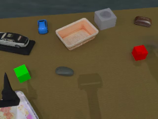

# 실제 검증 결과

## Docker 이전 검증 — 2026-10-09

`robotwin-phys:cuda12.1` 이미지를 실제 빌드했습니다. 자세한 이미지 ID와 실행 근거는 [docker-migration.json](../reports/docker-migration.json)에 있습니다. 이 과정에서 호스트 CUDA·NVIDIA 드라이버·Container Toolkit을 설치하거나 변경하지 않았습니다. 기존 `.env`는 보존했습니다.

| 검사 | 결과 |
|---|---|
| GPU 선택·launcher·실패 처리 | 8개 테스트 통과; 단일 GPU 자동 선택, 여러 GPU 선택, 중복 UUID 거부 포함 |
| 이미지 내부 simulator 테스트 | 23개 통과 |
| RTX 2080 Ti GPU 0 / GPU 1 | 각각 별도 non-root 컨테이너에서 CUDA 연산·Vulkan 렌더·23개 테스트 통과 |
| 기존 고정 episode 재현 | 각 GPU에서 seed 100000·100002의 초기 상태 일치 |
| 두 GPU 동시 expert rollout | GPU 0: stack_blocks_two, GPU 1: grab_roller, 모두 seed 100000 성공 |
| live 영상 | 포트 8765·8766에서 실제 JPEG frame과 task/seed status 수신 |
| Docker MP4 | stack_blocks_two 522 frame, grab_roller 184 frame; 모두 320×240, 30fps, decoding 확인 |
| 한 GPU로 순차 실행 | GPU 0에서 두 task의 기존 pool을 순서대로 source/runtime fingerprint와 검증 |
| 환경 격리 | assets 읽기 전용, 호스트 `.env` mount 없음, privileged 미사용, UID 1001 실행 |

현재 호스트에는 NVIDIA Container Toolkit이 없어 개별 GPU 장치와 기존 driver 파일을 컨테이너에 직접 연결하는 경로를 검증했습니다. Toolkit이 설치된 서버를 위한 표준 GPU reservation 구성도 제공하지만 해당 경로를 이 서버에서 실행 검증한 것은 아닙니다. 학습 모델 추론과 전체 50×100 benchmark 평가는 이번 Docker 검증에 포함하지 않았습니다.

[stack_blocks_two Docker 영상](../manifests/docker-dual-smoke/stack_blocks_two-verification/seed-100000.mp4) · [grab_roller Docker 영상](../manifests/docker-dual-smoke/grab_roller-verification/seed-100000.mp4) · [환경별 실행 방법](docker.md)

## 이전 호스트 환경 검증 — 2026-10-08

2026-10-08, 이 workspace의 RTX 2080 Ti에서 실행했습니다. 아래 결과는 모델 학습 성능 평가가 아닌 simulator/평가 infrastructure 검증입니다.

| 검사 | 결과 | 증거 |
|---|---|---|
| CUDA kernel 실행 및 실제 Vulkan camera render | 통과 | [hardware.json](../reports/hardware.json) |
| 설치 dependency 일관성 | `pip check` 통과 | hardware.json |
| 공식 assets 3개 LFS SHA-256 | 모두 일치 | [assets-verified.json](../reports/assets-verified.json) |
| sampling/RNG/manifest/RPC/MP4/π0.5 카메라 변환/실제 외력 물리 테스트 | 23개 통과 | [pytest.log](../reports/pytest.log) |
| 50 task × 100 seed의 물리 값 범위 | 단위 테스트에서 검사 | test_conditions.py |
| 부록 B의 9개 task 실제 scene 초기화 | 모두 통과 | [sensitive-tasks-summary.json](../reports/sensitive-tasks-summary.json) |
| robot/object 물리 적용 분리 | robot mass 1.0 유지, 대상 분리 확인 | sensitive-tasks 개별 result.json |
| external force | expert stage에서 0, policy stage에서 질량에 무관한 0.1g 가속 확인 | test_force_physics.py |
| physical_random expert rollout | stack_blocks_two 2개 성공 | [verified manifest](../manifests/verified-smoke-stack-blocks.json) |
| 새 프로세스의 초기 상태 비교 | 2개 모두 일치 | [replay summary](../runs/verified-smoke/replay/summary.json) |
| 별도 policy process와 실제 action RPC | 2개 완료, 각 3개 action | [policy summary](../runs/verified-smoke/policy/summary.json) |
| 평가 resume | 완료 episode 파일을 바꾸지 않음 | [e2e-summary.json](../reports/e2e-summary.json) |
| head camera MP4 | 320×240, 30fps, ffprobe decoding 확인 | e2e-summary.json |

확정된 seed는 **100000, 100002**입니다. 100001은 marker/shampoo가 불안정하여 expert pool 생성 단계에서 제외됐으며 해당 사유를 manifest에 저장했습니다. 두 policy 실행 모두 확정된 같은 seed와 condition hash를 사용했습니다.

9개 task 검사는 전역 physical range와 task 예외를 실제 simulator에 적용한 초기화 검사입니다. 9개 모두에서 expert rollout까지 성공했다는 뜻은 아닙니다. `scan_object`는 초기 seed 두 개가 불안정하여 100002에서 초기화 검사를 통과했습니다.

통신 검증에 사용한 `noop_infrastructure_test`는 현재 qpos를 유지하는 dummy policy입니다. 실제 학습 모델의 성능 수치로 사용할 수 없으며 summary의 `benchmark_eligible`은 false입니다. 실제 5개 학습 모델 추론과 전체 50 task × 100회 expert pool 생성/평가는 사용자 요청에 따라 추후 실행합니다.

headless MJPEG HTTP 응답/프레임 전달은 automated test로 검증했고 실제 rollout에서도 live server를 함께 실행했습니다. Native desktop viewer는 현재 shell에 DISPLAY가 없어 실행 검증하지 않았습니다. `--viewer`는 DISPLAY가 없으면 명확히 오류를 내고 `--live` 사용을 안내합니다.

expert 영상은 [seed-100000.mp4](../manifests/verified-smoke-stack-blocks-verification/seed-100000.mp4), [seed-100002.mp4](../manifests/verified-smoke-stack-blocks-verification/seed-100002.mp4)입니다. 각각 524프레임, 513프레임이며, rendering은 정책 관측과 별도로 물리 simulation time에 맞춰 획득합니다.

